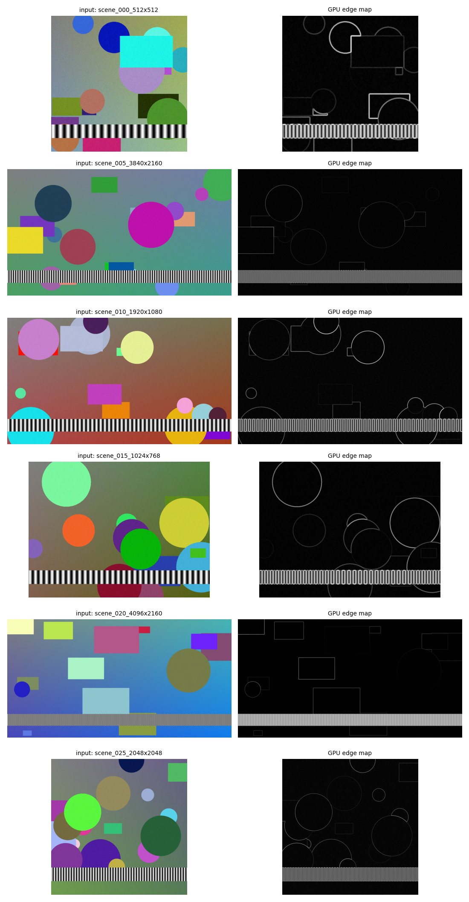
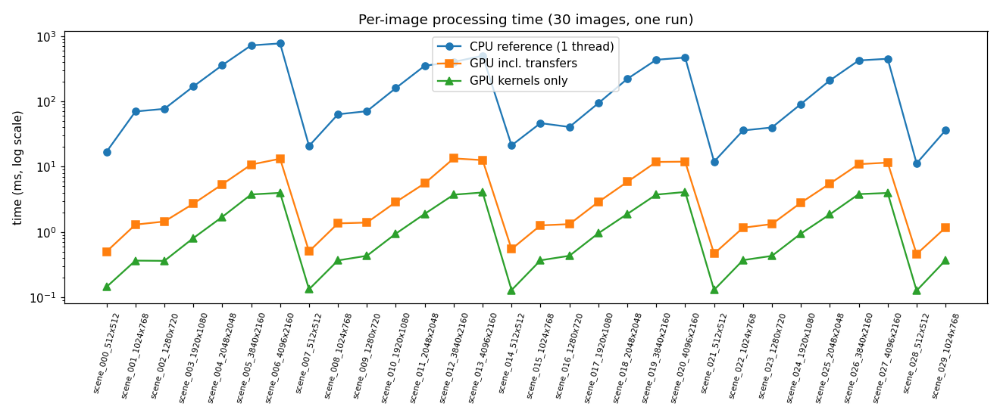
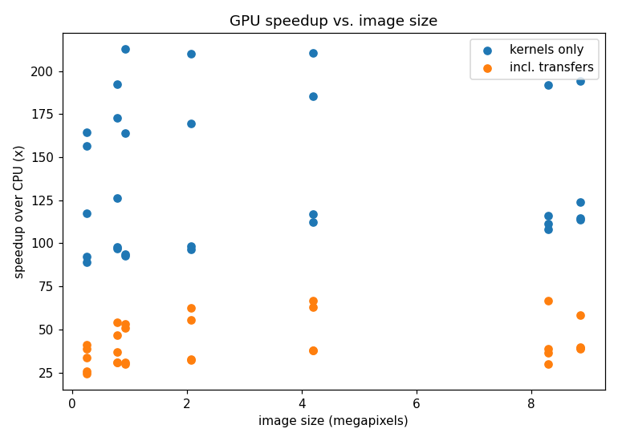

# Batch GPU Edge Detection with CUDA

A CUDA C++ command-line tool that runs an image edge-detection pipeline on
**a large batch of images in one run**. Every image goes through:

```
RGB image ─► grayscale ─► Gaussian blur (separable) ─► Sobel gradient ─► edge map (+ histogram)
```

Each stage is a custom CUDA kernel. A single-threaded CPU version of the
same pipeline checks every GPU result pixel by pixel and gives a speed
baseline.

## Why this project

Edge detection is the first step in many vision systems: lane detection,
document scanning, medical image segmentation. It is a stencil workload:
each output pixel reads a small neighbourhood of input pixels. That makes it
a good fit for the GPU techniques from the specialization: tiling with
shared memory, constant memory, coalesced access, atomics and CUDA events
for timing.

## Kernels / algorithms

| # | Kernel | Technique |
|---|--------|-----------|
| 1 | `ToGrayKernel` | 1D grid with one thread per pixel. Converts RGB to luma using `0.299R + 0.587G + 0.114B`. |
| 2 | `GaussianRowKernel` | 16×16 thread blocks. The block loads its tile **plus a halo of `radius` pixels** into **shared memory**, clamping at image borders. The Gaussian weights are in **`__constant__` memory**, so all threads in a warp read the same weight in one broadcast. |
| 3 | `GaussianColKernel` | Same tiling, vertical pass. A separable blur costs `2(2r+1)` operations per pixel instead of `(2r+1)²`. |
| 4 | `SobelKernel` | 3×3 Sobel stencil on a shared-memory tile. Gradient magnitude is `sqrt(gx²+gy²)`, with an optional binary threshold. Each block builds a **256-bin histogram in shared memory with `atomicAdd`** and then merges it into global memory. That makes far fewer global atomics than one per pixel. |

Other design points:

* `GpuPipeline` (RAII class) allocates device buffers once and only grows
  them. Batch processing does not pay for `cudaMalloc` on every image.
* Ping-pong buffers: the grayscale buffer is reused for the blur output, so
  the pipeline uses about 2 floats + 2 bytes of device memory per pixel.
* Timing uses `cudaEvent`s. *Kernel time* and *total time (including
  host↔device copies)* are reported separately, so the transfer cost is
  visible.
* `--verify` runs the CPU reference. A result passes when fewer than 0.1% of
  pixels differ by more than 1 gray level. Small differences are expected
  because the GPU fuses multiply-adds (FMA) and the CPU does not.

## Repository layout

```
src/
  main.cc            CLI, batch loop, verification, CSV logging
  gpu_pipeline.h/.cu CUDA kernels + GpuPipeline class
  cpu_reference.h/.cc  CPU oracle + Gaussian weight generation
  image_io.h/.cc     Dependency-free PPM/PGM reader/writer
  pipeline_types.h   Shared structs and constants
scripts/
  generate_data.py   Creates N synthetic test images (512x512 ... 4096x2160)
  convert_images.py  Converts your own jpg/png photos to PPM
  make_figures.py    Builds montage / timing / speedup plots
Makefile, run.sh     Build and one-command end-to-end run
run_on_colab.ipynb   Run everything on a free Google Colab GPU
output/              Proof artifacts (run_log.txt, timing.csv, figures/)
```

## Requirements

* NVIDIA GPU + CUDA Toolkit (nvcc, C++17). Tested target: Google Colab T4.
* Python 3 with `numpy`, `pillow` and `matplotlib` for the helper scripts.

## How to build and run

```bash
make                      # builds bin/edge_detect
./run.sh                  # build + generate 30 images + run + figures
```

`run.sh` options are set with environment variables:
`NUM_IMAGES=60 SIGMA=2.0 THRESHOLD=60 ./run.sh`

Running the binary directly:

```bash
./bin/edge_detect --input_dir data/input --output_dir output --sigma 1.5 --verify
```

| Argument | Meaning | Default |
|----------|---------|---------|
| `--input_dir DIR` | Folder of `.ppm` (P6) / `.pgm` (P5) images (**required**) | – |
| `--output_dir DIR` | Where `<name>_edges.pgm` files are written | `output` |
| `--sigma F` | Gaussian sigma, 0.3–2.6 px (radius = ceil(3σ) ≤ 8) | `1.5` |
| `--threshold N` | `0` = grayscale magnitude, `1–255` = binary edges | `0` |
| `--verify` | Also run the CPU reference and compare | off |
| `--no_save` | Skip writing images (benchmark only) | off |
| `--log FILE` | CSV of per-image timings | `<output_dir>/timing.csv` |

To run on your own photos:
`python3 scripts/convert_images.py --src my_photos --out data/input` and then `./run.sh`.

### No local NVIDIA GPU?

Open `run_on_colab.ipynb` in Google Colab. Choose *Runtime → Change runtime
type → T4 GPU*, then run all cells. The notebook builds the project, runs it
and shows the results.

## Proof of execution

A single run of the binary processes the **whole batch of 30 images**
(about 100 megapixels, 7 resolutions from 512×512 to 4096×2160). Artifacts
in `output/`:

* `run_log.txt` – console log showing the GPU name, a per-image line
  (size, kernel ms, total ms, CPU ms, speedup, PASS/FAIL) and a summary.
* `timing.csv` – the same data in machine-readable form.
* `figures/montage.png` – input images next to their GPU edge maps.
* `figures/timing.png`, `figures/speedup.png` – performance plots.

### Results

One execution on Google Colab (`sigma=1.5`; full log in
[output/run_log.txt](output/run_log.txt)):

| Metric | Value |
|--------|-------|
| GPU | Tesla T4 (compute 7.5, 40 SMs, 15 GB), CUDA 13.0 |
| Images / megapixels | 30 images / 102.6 MPix in one run |
| GPU kernel time | 46.3 ms → **2217 MPix/s** |
| GPU incl. host↔device copies | 144.1 ms → 712 MPix/s |
| CPU reference (1 thread) | 6392.8 ms → 16 MPix/s |
| Kernel speedup vs CPU | **138×** (per image 89×–213×) |
| End-to-end speedup vs CPU | **44×** |
| Verification vs CPU | **30/30 PASS** |





## Lessons learned

1. **Transfers dominate.** In the measured run, kernels took 46 ms but the
   whole GPU path took 144 ms, so about **68% of GPU time was PCIe
   copies**. End-to-end speedup is therefore 44×, not 138×. Fusing more work
   on the GPU per byte transferred, or overlapping copies with streams, is
   the way forward.
2. **Benchmark noise is real.** GPU kernel times were very stable: every
   4096×2160 image took 3.96–4.10 ms. The CPU time for the same image size
   dropped from 773 ms to 450 ms during the run, because the shared Colab
   vCPU's clock and cache behaviour vary. Per-image speedup therefore
   ranges from 89× to 213×. Aggregate numbers over the whole batch are the
   reliable ones to report.
3. **The shared-memory halo is the main design decision.** With radius r
   and a 16×16 tile, each block loads (16+2r)² values. At r = 8 that is
   4× the useful work, so blur cost grows with sigma faster than the
   arithmetic count alone suggests.
4. **Bit-exact GPU/CPU comparison is not realistic.** nvcc contracts `a*b+c`
   into FMA instructions, so a few pixels round differently. A tolerance
   based on how many pixels differ, not on any single difference, is the
   correct test.
5. **Per-block shared histograms** keep global atomic traffic small. Most
   pixels in an image fall into a few low-gradient bins, so a naive global
   atomic histogram would serialize heavily on those bins.

## Future work

* Overlap transfers and compute with CUDA streams and pinned memory,
  using multiple images in flight.
* Add non-maximum suppression and hysteresis to get a full Canny detector.
* Compare the hand-written kernels against NPP (`nppiFilterSobel…`) and
  OpenCV CUDA.
* Process video frames with NVDEC so frames stay on the GPU.
